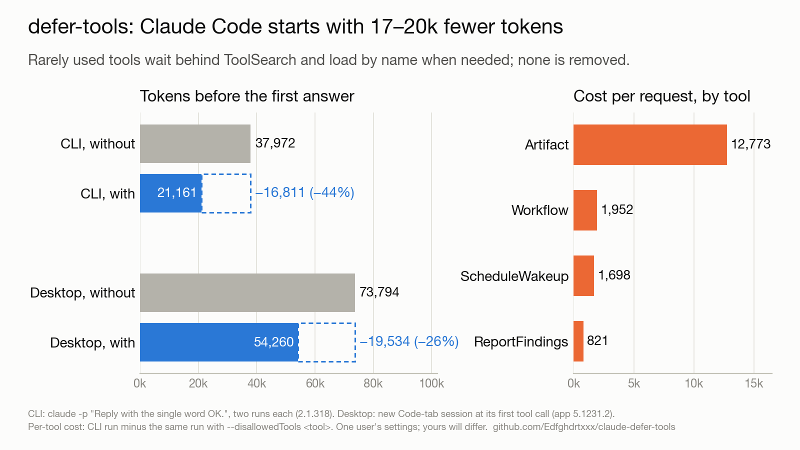
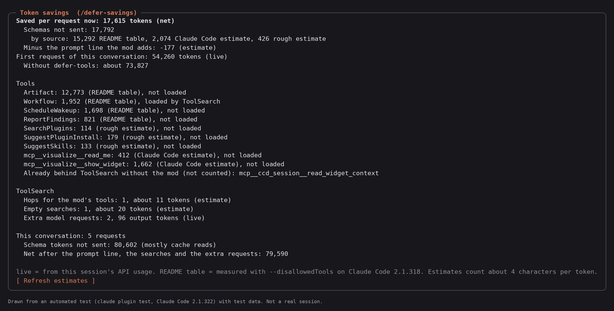

# defer-tools

A Claude Code mod that lists rarely used tools behind ToolSearch, so their schemas stop being sent with every request. The tools stay available: when the model needs one, it loads it by name with ToolSearch (`select:<name>`).

## Why

Claude Code sends the full JSON schema of every tool it lists "in front" with each request. A few built-in tools are large and seldom used. Removing one tool at a time with `--disallowedTools` and comparing the input tokens of `claude -p "Reply with the single word OK." --output-format json` gave:

| Tool | Input tokens it adds to every request |
| --- | ---: |
| `Artifact` | 12,773 |
| `Workflow` | 1,952 |
| `ScheduleWakeup` | 1,698 |
| `ReportFindings` | 821 |

A `permissions.deny` rule saves those tokens too, but it removes the tool. This mod keeps every tool usable.

## Results



| Where | Without the mod | With the mod | Saved |
| --- | ---: | ---: | ---: |
| CLI, `claude -p` as above (two runs each) | 37,971 / 37,973 | 21,160 / 21,161 | 16,811 (44%) |
| Desktop app, Code tab, new session at its first tool call | 73,794 | 54,260 | 19,534 (26%) |

In the desktop app's context breakdown, "System tools" fell from 16,802 tokens to none and "MCP tools" from 6,508 to 4,434, while "System prompt" grew by 286 for the line this mod adds. The desktop run with the mod also deferred three Claude Docs connector tools through the `alsoDefer` option.

Tests that pass:

- `select:Artifact,Workflow,ScheduleWakeup,ReportFindings` loads all four tools.
- An MCP tool deferred by the mod loads and runs.
- In the desktop app, all 13 deferred tools load on request, and `mcp__visualize__read_me` and a Docs connector tool ran after loading.

Measured on macOS with Claude Code 2.1.318 (CLI) and the Claude desktop app 5.1231.2, on one user's settings, so your numbers will differ.

## What it changes

- A `tool.describe` hook returns `isDeferred: true` for each tool in its list. The tool's description is left as Claude Code computed it.
- A `prompt.compose` hook adds one system-prompt line that names the deferred tools the session offers, each with a short hint. In the CLI tests, Claude Code's own list of deferred tools did not name tools deferred this way, so without this line the model would not know they exist.

Default list:

- Built-in: `Artifact`, `Workflow`, `ScheduleWakeup`, `ReportFindings`
- Desktop app: `SearchPlugins`, `SuggestPluginInstall`, `SuggestSkills`, `mcp__visualize__read_me`, `mcp__visualize__show_widget`, `mcp__ccd_session__read_widget_context`

A name the session does not offer is ignored, and a tool removed by a deny rule is not named in the line.

## Install

At the prompt of a terminal session:

```
/plugin install defer-tools --marketplace Edfghdrtxxx/claude-defer-tools
```

From a shell:

```bash
claude plugin install defer-tools --marketplace Edfghdrtxxx/claude-defer-tools
```

In the desktop app, where `/plugin` does not run: click + next to the prompt box, then Plugins, Add marketplace with `Edfghdrtxxx/claude-defer-tools`, then Add plugin.

Answer `y` to add the marketplace, then pick the user scope. The change applies to sessions started afterwards and after `/clear`.

## Options

- `alsoDefer`: comma-separated tool names to defer as well, for example the tools of an MCP connector you rarely use.
- `keepInFront`: comma-separated names from the default list to leave in the prompt.
- `statusLine`: show the savings under the prompt (on by default).

Set them with `/plugin configure defer-tools@defer-tools`, or from a shell:

```bash
printf '%s' '{"keepInFront":"Workflow"}' | claude plugin configure defer-tools@defer-tools --values-stdin
```

## See what it saves

Since 0.2.0 the mod shows its savings while you work, in the CLI and in the desktop app.

- **Status line**, under the prompt: `defer-tools: saves 16k tokens per request · 1 ToolSearch hop, 0 empty searches`. Turn it off with the `statusLine` option.
- **Pane**, opened with `/defer-savings`: the full count for the current conversation. Where no pane can be drawn, the command answers with the same report as text.



The picture is drawn from `tests/screenshots.test.tsx` with test data, not taken from a real session; `claude plugin test . | python3 scripts/render-screenshots.py` draws it again.

The pane shows:

- Saved per request now, net: the schemas not sent, minus the system-prompt line the mod adds.
- The first request of the conversation as the API reported it, and about what it would have been without the mod.
- Each deferred tool with its tokens, where that figure comes from, and whether ToolSearch has loaded it. A loaded tool's schema rides in the conversation from then on, so it stops counting as saved.
- ToolSearch: hops (searches that loaded one of the mod's tools), empty searches (searches that found nothing), and the extra model requests whose only tool calls were ToolSearch.
- This conversation's totals, and a total over the sessions on this computer.

Every number says where it comes from, so the display does not overstate:

| Label | Meaning |
| --- | --- |
| live | From this session's API usage (input and output tokens of real requests). |
| README table | The table above: a `claude -p` run minus the same run with `--disallowedTools`, Claude Code 2.1.318. Used for `Artifact`, `Workflow`, `ScheduleWakeup`, `ReportFindings`. |
| Claude Code estimate | Claude Code's own estimate of an MCP tool's schema, as `/context` counts it (no API call). |
| rough estimate | This mod's estimate from the tool's description alone, about 4 characters per token. It leaves out the schema's parameters, so it is low. Used for other tools, like the desktop app's `SearchPlugins`. |
| estimate | The prompt line and the ToolSearch calls and results, also about 4 characters per token. |

How it counts:

- Only tools Claude Code would have kept in front count. A tool Claude Code already lists behind ToolSearch by itself (most MCP tools) is shown as "not counted".
- Net for the conversation = schema tokens not sent over all requests, minus the prompt line on every request, minus the hops and empty searches with their results (estimate), minus the output tokens of the extra requests (live).
- "Schema tokens not sent" adds the saving of every request. Most of those tokens would have been prompt-cache reads, which cost less than new input, so treat that total as context kept free, not as money saved.
- Each hop also costs one more model request, which reads the conversation again (mostly from the cache). The net subtracts that request's output tokens, but not the context it reads again.
- Only the main conversation is counted, not subagents. A `/clear` starts the counts over.

## Costs and limits

- The first call of a deferred tool in a session takes one extra ToolSearch step.
- The added line costs about 130 tokens in the CLI and about 290 in the desktop app.
- The mod uses the mods API (`tool.describe`, `prompt.compose`, and for the display `turn.step`, `tool.call`, `$.session.usage`, `$.ui.status`, a pane) of the builds above; a later build may change it.
- The savings display was tested with `claude plugin test` on Claude Code 2.1.322 (`tests/savings.test.tsx`, all four surfaces), not yet in a live CLI or desktop session.
- Some MCP connectors expect their tools to stay in front. The Claude Docs connector's own help says its `batch`, `guide` and `update` tools are "always listed"; deferring them worked in the test above, but if a connector misbehaves, put its tools in `keepInFront` or leave them out of `alsoDefer`.

## Uninstall

```bash
claude plugin uninstall defer-tools@defer-tools
```

## Related

Feature request for loading the Artifact tool on demand: [anthropics/claude-code#102032](https://github.com/anthropics/claude-code/issues/102032).

## License

MIT
